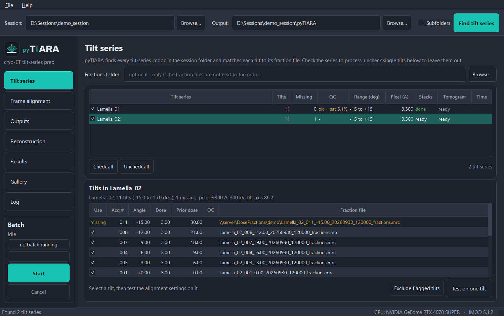

<p align="center"></p>

# pyTIARA

**TIlt-series Alignment and Reconstruction, Automated: cryo-ET tilt-series
preparation for Windows.** pyTIARA aligns the dose
fractions of every tilt on the GPU, builds etomo-ready tilt-series stacks, and
reconstructs tomograms automatically with IMOD. It processes a whole session at
once, from a desktop app or from the command line.



> **pyTIARA was called pyPrep until November 2026.** The name changed because
> `pyprep` is an unrelated EEG package. Output folders written by pyPrep still
> open, and old links to the repository redirect here. See
> [Coming from pyPrep](docs/installation.md#coming-from-pyprep).

## What it does

For every tilt series in a session folder, pyTIARA:

1. **Reads the `.mdoc`** written by Thermo Fisher **Tomo5** or **SerialEM**,
   and finds each tilt's movie file. These can be MRC fractions (for example
   Tomo5 K3), TIFF stacks, or Falcon **EER** files.
2. **Aligns the frames of every tilt** on the GPU and sums them. The alignment
   is iterative, in the style of MotionCor, and is robust to detector
   fixed-pattern noise.
3. **Writes stacks sorted by tilt angle** at the binnings you choose. Each
   stack has a `.rawtlt` and a re-ordered `.mdoc`, so etomo picks up the tilt
   angles, tilt axis, pixel size and dose. Even/odd half-sums (for denoising)
   and dose-weighted stacks are optional.
4. **Runs IMOD batchruntomo** to produce a **tomogram**, at bin 4 by default.
   You can choose patch tracking or gold fiducials. The result is a normal
   etomo project that you can open and refine.

pyTIARA flags problem tilts (dark or blocked, drifting, poorly aligned) before
and after processing, warns about saturated fraction files, resumes interrupted
batches, and skips missing tilts. Its viewer shows the stacks, tomograms and
per-tilt drift and QC plots, and exports TIFF for Fiji. A **Gallery** shows a
thumbnail of every tomogram in the session, with its name, to pick the best data
to take further. pyTIARA measures the **defocus of every tilt** on the GPU (tilt-aware, with
automatic handedness), phase-flips the stack in IMOD with it, and writes a
**deconvolved tomogram** with stronger contrast for viewing and segmentation.
With the optional ASTRA Toolbox it also writes a tomogram with the **redeposition
removed**: the dense surface layers of FIB lamellae (redeposition, Pt/GIS grains)
are taken out of the tilt series, so their shading and blotches leave the interior.
Tomograms have the specimen's **handedness** by default: Tomography 5 images,
which are stored upside down, are inverted in Y, and the defocus gradient
checks the direction of the tilt axis.
When IMOD's automatic positioning fails, **Position tomogram**
lets you mark the top and bottom of the specimen. pyTIARA then rebuilds the
tomogram flat, centred and at the right thickness.

## Quick start

1. Install [Miniconda](https://docs.conda.io/en/latest/miniconda.html). For
   reconstruction, also install
   [IMOD for Windows](https://bio3d.colorado.edu/imod/).
2. Download pyTIARA, either with
   `git clone https://github.com/pyRIME/pyTIARA.git` or with
   **Code > Download ZIP**. Then double-click **`install.bat`**.
3. Double-click **`pyTIARA.bat`**.
4. Choose the **Session** folder (the one with the `.mdoc` files) and an
   **Output** folder. Click **Find tilt series**, then **Start**.

Each tilt series ends up in `<Output>\<series>\`:

| File | Contents |
|---|---|
| `<series>.mrc`, `<series>_bin4.mrc` | motion-corrected tilt series, sorted by tilt angle |
| `.rawtlt`, `.mrc.mdoc` | tilt angles and metadata for etomo |
| `imod_bin4\<series>_rec.mrc` | tomogram (`imod_bin4\<series>.edf` opens the etomo project) |
| `imod_bin4\<series>_rec_deconv.mrc` | deconvolved tomogram, for viewing and segmentation |
| `imod_bin4\<series>_rec_redep.mrc` | tomogram with the redeposition removed (optional, needs ASTRA) |
| `<series>.defocus` | per-tilt defocus (IMOD format) |
| `_motion.csv`, `_pytiara.json`, `_pytiara.log` | frame shifts, full record of the run, log |

## Documentation

| Page | Covers |
|---|---|
| [Installation](docs/installation.md) | requirements, installer options (GPU/CUDA builds), IMOD, updating |
| [User guide](docs/user-guide.md) | every page and setting of the app, running a batch, continuing in etomo |
| [Command line](docs/command-line.md) | `pytiara scan`, `run`, `ctf`, `deconv`, `gallery`, `export`, the settings file |
| [Output files](docs/outputs.md) | what each file contains |
| [How it works](docs/how-it-works.md) | algorithms, validation, references |
| [Troubleshooting](docs/troubleshooting.md) | GPU, missing tilts, gain references, IMOD |

## Requirements

- Windows 10 or 11 (64-bit), with 16 GB of RAM or more.
- An NVIDIA GPU with driver 452.39 or newer. It was tested on a Quadro M4000
  with 8 GB. The GPU is optional, but running on the CPU is 10–50 times slower.
- Miniconda. The installer uses it to create a private Python 3.11 environment.
- IMOD 4.11 or newer for Windows, needed only for reconstruction.

## Supported data

| Input | Notes |
|---|---|
| Tomo5 or SerialEM `.mdoc` | tilt angles, collection order, dose, pixel size, tilt axis, movie file names |
| MRC fractions | all MRC modes, including 8-bit (Tomo5 K3, already gain-normalized) and 4-bit |
| TIFF frame stacks | for example from SerialEM; gain reference as MRC or TIFF (convert `.dm4` with IMOD `dm2mrc`) |
| Falcon EER | codecs 65000–65002; grouped into fractions; 4K or 8K super-resolution; EPU `.gain` reference |

EER support has been tested on synthetic EER files but not yet on real Falcon
data. Please report how it works on yours.

## Performance

On a Quadro M4000, a 46-tilt K3 series (5760 x 4092 pixels, 4 fractions per
tilt) takes about 40 s for frame alignment plus the bin 1 and bin 4 stacks.
CTF estimation adds about 15 s, and the bin-4 batchruntomo reconstruction about
2 minutes. Deconvolution then takes about 10 s. Frame shifts agree with IMOD
`alignframes` to within about 0.03 px. Per-tilt defocus agrees with IMOD
`ctfplotter` to within about 40 nm RMS.

## Development

```bat
env\python.exe -m pytest          # unit tests, on synthetic data
env\python.exe -m pytiara --help   # command line
```

The code is organised as follows:

- `pytiara/io`: MRC, mdoc, EER and gain-reference files
- `pytiara/motion.py`: frame alignment
- `pytiara/ctf.py`, `pytiara/deconv.py`: CTF estimation, tomogram deconvolution
- `pytiara/positioning.py`: interactive tomogram positioning
- `pytiara/redep.py`, `pytiara/lamella.py`: redeposition removal, and the lamella locator it uses
- `pytiara/pipeline.py`: processing a tilt series
- `pytiara/imod.py`: running batchruntomo
- `pytiara/gui`: the PySide6 app

See [How it works](docs/how-it-works.md) for details.

## License and citation

pyTIARA is released under the [BSD 3-Clause License](LICENSE). You may use,
modify and redistribute it, including commercially, provided you keep the
copyright notice and do not use the author's name to promote derived products.

Redeposition removal uses the [ASTRA Toolbox](https://astra-toolbox.com), an
optional dependency under the GPLv3 that pyTIARA does not include. Install it with
`pip install astra-toolbox` (or `pip install -e ".[redep]"`). A redistributed
bundle of pyTIARA together with ASTRA falls under the GPLv3's terms.

To cite pyTIARA, use **Cite this repository** on the GitHub page (from
[`CITATION.cff`](CITATION.cff)).

## Acknowledgements

pyTIARA builds on ideas from MotionCor2/3 (frame alignment).

- [IMOD](https://bio3d.colorado.edu/imod/) for tilt-series alignment and
  reconstruction;
- [PyTorch](https://pytorch.org) for GPU computing;
- the [ASTRA Toolbox](https://astra-toolbox.com) for the SIRT of redeposition
  removal (optional; van Aarle et al., Ultramicroscopy 2015; Opt. Express 2016);
- [imagecodecs](https://github.com/cgohlke/imagecodecs) and
  [tifffile](https://github.com/cgohlke/tifffile) for EER decoding.

References for the methods are listed in
[How it works](docs/how-it-works.md#references). If you use pyTIARA, please cite
IMOD and the methods it implements.
